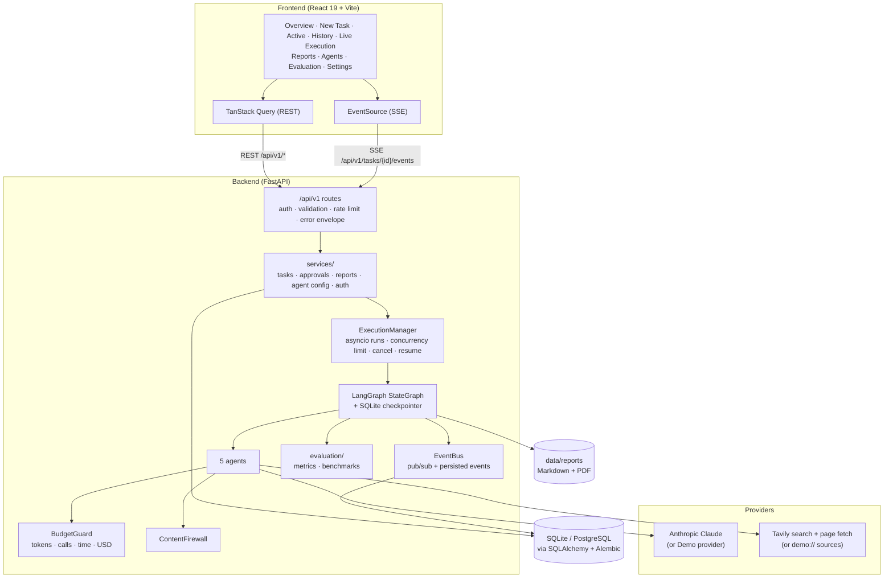
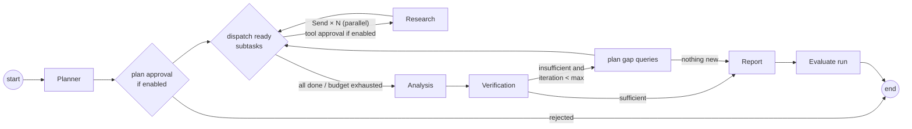

# AgentFlow

**Autonomous multi-agent AI task execution platform.** AgentFlow takes a natural-language research or
analysis objective, has a Planner decompose it into a dependency graph of subtasks, runs Research
agents in parallel against the web, analyses and verifies every claim against the retrieved evidence,
and produces a cited Markdown/PDF report. The whole execution streams live to a React dashboard, with
human-approval checkpoints and hard cost/token limits.

> **Status.** Phases 1–4 are implemented and verified **offline** (backend unit/integration tests,
> frontend unit tests, Playwright browser tests against the real backend in demo mode).
> **Live AI execution has not yet been verified with real credentials.** The live test suite and its
> spending caps are ready (see [docs/phase4.md](docs/phase4.md#live-verification-runbook)), but no
> Anthropic/Tavily keys were available. Everything below that says "demo" is template output, not AI output.

---

## Contents
1. [Problem statement](#problem-statement) · 2. [Objectives](#objectives) · 3. [Key features](#key-features) ·
4. [The five agents](#the-five-agents) · 5. [Technology stack](#technology-stack) ·
6. [System architecture](#system-architecture) · 7. [Agent execution workflow](#agent-execution-workflow) ·
8. [Backend](#backend-architecture) · 9. [Frontend](#frontend-architecture) · 10. [Database](#database-design-and-migrations) ·
11. [Requirements](#installation-requirements) · 12. [Configuration](#environment-configuration) ·
13. [Running the backend](#backend-setup) · 14. [Running the frontend](#frontend-setup) · 15. [Demo mode](#demo-mode) ·
16. [Testing](#testing) · 17. [Reports](#report-generation-and-download) · 18. [Security and cost controls](#security-and-cost-controls) ·
19. [Known limitations](#known-limitations) · 20. [Future improvements](#future-improvements)

---

## Problem statement

A single LLM prompt is a poor tool for research: it can't search, it invents sources, it doesn't say
which statements are actually supported, and it gives no visibility or control over cost. Real research
needs decomposition, evidence gathering, cross-checking and an auditable trail from each claim back to
its source, with a human able to stop or redirect the process.

## Objectives

- Decompose an objective into a dependency-aware plan and execute independent parts in parallel.
- Ground every fact in retrieved evidence and drop anything that can't be traced to a source.
- Verify claims independently and report a verdict, confidence and reasoning for each.
- Keep spending bounded and predictable (token, call, time and USD limits enforced in code).
- Make execution observable (live event stream) and controllable (approvals, cancel, retry).
- Treat all web content as untrusted (prompt-injection defence).
- Provide an honest demo mode that works with no API keys and is never presented as AI output.

## Key features

- **LangGraph orchestration:** typed shared state with reducers, dependency-aware parallel fan-out
  (`Send`), verification-driven research loops with a hard iteration limit, persistent checkpoints.
- **Five specialised agents** with Pydantic input/output contracts and per-agent tool allowlists.
- **Human-in-the-loop approvals** (`interrupt()`): approve the plan, each batch of web searches, or both;
  with comments; survives a server restart.
- **Grounding gates:** each fact's evidence quote must occur in the cited source text (otherwise it is
  re-attributed or dropped); citations in the report are filtered to stored sources.
- **Cost governance:** per-task limits on tokens, LLM calls, tool calls, wall time and USD; up-front cost
  estimate; a reserve that keeps a final report possible when the budget runs out.
- **Prompt-injection firewall:** web text is sanitised, flagged and isolated from instructions.
- **Live UI:** workflow graph, SSE event timeline (reconnect + replay), sources, verification verdicts,
  approval cards, report viewer, analytics and an evaluation dashboard.
- **Evaluation:** per-run citation integrity, grounding, source coverage, verification stats, cost and
  latency, plus a labelled verification benchmark and an offline benchmark of the safety gates.
- **Demo mode:** the full pipeline with fixed templates and `demo://` sources, labelled `[DEMO]` everywhere.

## The five agents

| # | Agent | Responsibility | Tools |
|---|---|---|---|
| 1 | **Planner** | Turns the objective into 1–12 subtasks with dependencies and search queries | none |
| 2 | **Research** | One instance per subtask (in parallel): web search, page fetch, extracts facts with verbatim evidence quotes | `web_search`, `fetch_page` |
| 3 | **Analysis** | Merges facts into claims, runs calculations, notes conflicts and gaps | `calculator` |
| 4 | **Verification** | Checks each claim against retrieved evidence (BM25): verdict, confidence, reasoning; decides whether more research is needed | evidence retrieval |
| 5 | **Report** | Writes the final cited report; references are generated from stored sources, not by the model | none |

Contracts: `backend/app/schemas/agent_io.py`. Prompts: `backend/app/agents/prompts.py`.

## Technology stack

| Layer | Technology |
|---|---|
| Backend API | Python 3.13, FastAPI, Uvicorn, sse-starlette (SSE), slowapi (rate limiting) |
| Orchestration | LangGraph 1.x with SQLite checkpointer |
| LLM providers | Anthropic Claude (`anthropic` SDK, structured outputs); Gemini provider also present; demo provider |
| Search / extraction | Tavily, httpx, trafilatura, rank-bm25 |
| Data | SQLAlchemy 2 (async), Alembic, SQLite (default) or PostgreSQL (asyncpg) |
| Reports / auth | markdown-it-py, ReportLab (PDF), PyJWT session cookie, bcrypt |
| Frontend | React 19, TypeScript, Vite, Tailwind CSS 4, Radix UI / shadcn-style components, TanStack Query, React Router, Recharts, react-markdown |
| Testing | pytest + pytest-asyncio, Vitest + Testing Library, Playwright, oxlint |

## System architecture



More detail, including design decisions: [docs/architecture.md](docs/architecture.md).

## Agent execution workflow

This is the actual graph built in `backend/app/graph/builder.py`:



- Subtasks run in dependency layers; within a layer they run in parallel (or one at a time in
  sequential mode). Concurrent searches per task are bounded by `MAX_PARALLEL_SEARCHES`.
- A failed research subtask is non-fatal (disclosed in the report). If Analysis fails, raw facts are
  used as claims; if Verification fails, claims are reported as unverified (`agent_degraded`).
- When a budget limit is hit, remaining research is skipped and the report is still produced with a
  budget note.
- Every step emits persisted events (`task_started`, `plan_created`, `dispatch`, `source_added`,
  `approval_requested`, `verification_completed`, `report_ready`, `task_finished`, …).

## Backend architecture

```
backend/
  app/
    main.py            FastAPI app factory, lifespan (migrations, executor, recovery)
    api/routes/        auth, tasks (+ SSE events), approvals, reports, agents, insights, system
    services/          task_service, execution_manager, execution_store, budget, events,
                       report_renderer, pdf, agent_config_service, auth_service
    graph/             state.py (typed state + reducers), nodes.py, builder.py, runner.py
    agents/            planner, research, analysis, verification, report, prompts, specs
    llm/               provider interface, Anthropic, Gemini, retry/backoff, model registry
    tools/             search (Tavily), fetch (SSRF-guarded), evidence (BM25), quality, calculator
    security/          content_firewall.py (prompt-injection defence)
    demo/              demo LLM + search providers and templates
    evaluation/        run metrics and benchmark suites
    database/, models/, schemas/, config/ (settings.py, pricing.json), utils/
  migrations/          Alembic revisions
  tests/               unit/, integration/, live/ (opt-in, paid)
```

Key API endpoints (`/api/v1`, interactive docs at `/api/docs`):

| Area | Endpoints |
|---|---|
| Auth | `POST /auth/login`, `POST /auth/logout`, `GET /auth/me` |
| Tasks | `POST /tasks`, `GET /tasks`, `GET /tasks/{id}`, `POST /tasks/{id}/cancel`, `POST /tasks/{id}/retry`, `DELETE /tasks/{id}` |
| Task detail | `GET /tasks/{id}/events` (SSE), `/sources`, `/verifications`, `/usage` |
| Approvals | `GET /approvals`, `POST /approvals/{id}/decision` (`{"approved": true, "comment": "..."}`) |
| Reports | `GET /reports`, `GET /reports/{id}`, `GET /reports/{id}/download.md`, `GET /reports/{id}/download.pdf` |
| Agents / models | `GET /agents`, `PUT /agents/{key}`, `GET /models` |
| Insights | `GET /analytics/overview`, `GET /evaluations/summary`, `/evaluations/runs`, `/evaluations/tasks/{id}`, `/evaluations/benchmarks`, `POST /evaluations/benchmarks/{suite}/run` |
| System | `GET /health`, `GET /system/status` |

## Frontend architecture

```
frontend/src/
  pages/        Overview, NewTask, ActiveExecutions, History, TaskExecution (live view),
                Reports, ReportViewer, Agents, Evaluation, Settings, Login
  components/   execution/ (workflow graph, event timeline, research panels, outputs),
                report/ (safe Markdown renderer), charts/, approval-card, ui/ (Radix-based)
  hooks/        use-tasks, use-task-events (SSE), use-auth, use-system, …
  services/     api.ts (typed REST client), event-stream.ts (SSE with reconnect + replay)
  lib/, types/
```

- The Vite dev server proxies `/api` to the backend, so the session cookie is same-origin
  (override the target with `AGENTFLOW_API`).
- The event stream reconnects with `Last-Event-ID` / `?after=<id>` and replays missed events; a heartbeat
  watchdog detects silently dead connections.
- Reports are rendered without raw HTML; only `http(s)` links are clickable; remote images are not loaded.

## Database design and migrations

Tables (`backend/app/models/`): `users`, `tasks`, `subtasks`, `agent_executions`, `execution_events`,
`research_sources`, `verification_results`, `approval_requests`, `reports`, `evaluation_results`,
`benchmark_runs`, `agent_configs`. LangGraph checkpoints are kept in a separate SQLite file
(`data/checkpoints.db`).

- Migrations: Alembic (`backend/migrations`, revisions `0001_baseline`, `0002_tasks_runtime_state`).
- The schema is migrated automatically on startup. To migrate manually: `python -m app.database.migrations`.
- SQLite databases are backed up to `backend/data/backups/` before any schema change.

## Installation requirements

- Python 3.13 (3.12+ should work; developed and tested on 3.13)
- Node.js 20+ and npm (developed with Node 24)
- Optional for live mode: an Anthropic API key **with API credits** and a Tavily API key.
  A Claude Pro/Max subscription does not include API credits.

## Environment configuration

```bash
cp .env.example .env      # at the repository root (backend/.env also works)
```

| Variable | Needed for | Notes |
|---|---|---|
| `JWT_SECRET` | always | Signs session cookies. **Required in production**; the app refuses to start with the built-in or example placeholder. |
| `ADMIN_USERNAME` / `ADMIN_PASSWORD` | login | Development default `admin` / `admin`. In production set `ADMIN_PASSWORD_HASH` (bcrypt) instead. |
| `ANTHROPIC_API_KEY` | live mode | Secret; never logged or returned by the API. |
| `ANTHROPIC_DEFAULT_MODEL` | live mode | Validated against the live model list; must be in `app/config/pricing.json` if a cost cap is set. |
| `TAVILY_API_KEY` | live mode | Web search. |
| `DATABASE_URL` | optional | Default SQLite in `backend/data/`. PostgreSQL via `postgresql+asyncpg://…`. |
| `DEFAULT_MAX_*`, `MAX_*` | optional | Per-task default limits and server ceilings. |
| `DEFAULT_MAX_COST_USD`, `APPROVAL_COST_THRESHOLD_USD` | optional | Hard USD cap; estimate above which approval is required. |

All variables are documented in [.env.example](.env.example). Without the three live-mode variables the
app runs normally and only demo tasks can be started (live tasks are refused with `provider_not_configured`).

## Backend setup

```bash
cd backend
python -m venv .venv
.venv\Scripts\activate            # Windows   (macOS/Linux: source .venv/bin/activate)
pip install -r requirements-dev.txt
uvicorn app.main:app --reload --port 8000
```

- API docs: <http://localhost:8000/api/docs>
- Health: <http://localhost:8000/api/v1/health>

## Frontend setup

```bash
cd frontend
npm install
npm run dev                       # http://localhost:5173 (proxies /api to :8000)
```

Production build: `npm run build` (output in `frontend/dist/`, preview with `npm run preview`).

## Demo mode

Demo mode needs **no API keys** and is the recommended way to present the project.

1. Start the backend and frontend as above and open <http://localhost:5173>.
2. Sign in (`admin` / `admin` by default). The header shows **Demo only** when no live keys are configured.
3. **New Task** → enter an objective (e.g. *"Compare the levelised cost of solar and onshore wind energy"*),
   choose **Demo** mode, and optionally set **Approval: plan** (or tools/all) to demonstrate checkpoints.
4. The live execution page opens: watch the workflow graph, the event timeline, and the Research agents
   running in parallel. If approval is enabled, approve the plan (with an optional comment) or reject it.
5. When it completes, inspect **Sources** and **Verification**, then open the report and download it as
   Markdown or PDF.
6. Show **Execution History**, **Overview** analytics and the **Evaluation** dashboard.

Demo output is produced from fixed templates (`backend/app/demo/`). The report title, every paragraph and
every source are labelled `[DEMO]` / `demo://`, and the report begins with an explicit
"DEMO MODE — not research" notice. Demo runs are labelled separately in analytics and evaluation.

### Suggested 5-minute presentation walkthrough
1. **Problem (30 s):** single-prompt LLM research is unverifiable and uncontrolled.
2. **Architecture (1 min):** the five agents and the LangGraph workflow diagram above.
3. **Live demo (2.5 min):** create a demo task with plan approval → approve → watch parallel research,
   verification verdicts and the event timeline → open and download the report.
4. **Engineering depth (1 min):** grounding gate (quotes must exist in the source), budget enforcement
   before each call, prompt-injection firewall, SSE replay after reconnect, approvals surviving a restart.
5. **Honesty note:** the demo is templated; live AI mode is implemented with a capped test suite but has
   not been run against paid APIs yet.

## Testing

```bash
# Backend: offline unit + integration tests (no network, no keys)
cd backend
python -m pytest

# Offline benchmark of the safety gates (free, no model)
python -m app.evaluation.benchmarks guards

# Frontend
cd frontend
npm test              # Vitest unit tests
npm run lint          # oxlint
npm run typecheck     # tsc
npm run build         # production build

# Browser tests: start the backend (:8000) and `npm run dev` (:5173) first
npx playwright install chromium   # once
npx playwright test
```

**Live tests (paid, opt-in).** `python -m pytest -m live -s` calls real Anthropic/Tavily APIs. Each test has
a hard spending cap enforced before every call, and a missing key is reported as a skip, never as a pass.
Run them step by step following [the runbook](docs/phase4.md#live-verification-runbook). The cheapest
reliable choice for a first live run is `ANTHROPIC_DEFAULT_MODEL=claude-sonnet-5-5` (about half the cost
of Opus, with refusal fallback support).

**Latest verified results (offline):** backend 235 passed (12 live tests deselected); frontend 60 unit
tests passed; lint 0 errors; typecheck and build pass; Playwright 5/5 passed against the real backend in
demo mode (15/15 over three serial repetitions). Live credentialed tests: not run (no credentials).
The Playwright specs share one backend, so run them with the default worker count or `--workers=1`, not
with `--repeat-each` in parallel (copies of the same spec delete each other's tasks).

## Report generation and download

1. The Report agent writes Markdown prose with `[S#]` citations. Citations that don't point at a stored
   source, links/images/URLs not backed by a source, and raw HTML are removed and disclosed.
2. The reference list is generated from stored sources; limitations (budget, failed subtasks, degraded
   agents, conflicting claims) are added by code, not left to the model.
3. Markdown and PDF (ReportLab) are written to `backend/data/reports/`.
4. In the UI: **Reports** → open a report → **Download MD / PDF**. API:
   `GET /api/v1/reports/{id}/download.md` and `/download.pdf` (authenticated).

## Security and cost controls

- **Auth:** single local admin; HTTP-only signed session cookie; login rate-limited (10/min); every API
  route except health requires a session. Production refuses default/placeholder secrets and a plain-text
  admin password.
- **Secrets:** API keys are `SecretStr`, redacted from logs, errors, events and tracebacks, and only
  reported by the API as "configured". `.env` is git-ignored.
- **Untrusted content:** web pages are sanitised (including Unicode tag-character smuggling), flagged by
  injection rules, and passed to models only inside escaped data wrappers. Agents can only call tools
  on their allowlist; the fetcher only reads URLs returned by search and blocks private addresses (SSRF guard).
- **Cost:** per-task limits on tokens, LLM calls, tool calls, wall time, iterations and USD, clamped to
  server ceilings. The USD cap is enforced *before* each call by clamping output so the worst case fits;
  a cap that cannot be enforced (unpriced model) fails up front. Tasks whose estimate exceeds
  `APPROVAL_COST_THRESHOLD_USD` require approval. `MAX_CONCURRENT_TASKS` bounds parallel runs.

## Known limitations

- **Live AI mode has not been verified with real credentials** in this repository's history; only the
  free real-endpoint error checks (invalid key, timeout) were run.
- Injection detection is heuristic (measured false positives on benign text); structural isolation is the real control.
- Quote grounding proves a quote exists in a source, not that the statement follows from it (that is the
  Verification agent's job).
- The cost cap uses an input-token estimate; actual spend can slightly exceed it by the estimation error.
- Single admin user; no multi-user accounts or roles.
- LangGraph checkpoints use SQLite even when the main database is PostgreSQL (single node only); no
  automatic backup before PostgreSQL migrations.
- Evidence retrieval is BM25 (no embeddings). SSRF guard has a theoretical DNS-rebinding window.
- The UI does not yet visualise the Phase 4 grounding/cost metric blocks or the `guards` benchmark (the API returns them).
- `npm audit` reports high-severity findings in Vite's dev-dependency chain; fixing them requires a breaking Vite upgrade.

## Future improvements

- Run and record the capped live verification suite once API credits are available.
- Visualise the Phase 4 evaluation metrics in the Evaluation dashboard.
- Embedding-based evidence retrieval; PostgreSQL checkpointer for multi-node deployment.
- Multi-user accounts with roles; container packaging.

## Documentation

- [Architecture and design decisions](docs/architecture.md)
- [Roadmap and phase notes](docs/roadmap.md)
- [Phase 4: advanced AI capabilities, results, live verification runbook](docs/phase4.md)
