# AgentFlow — Final Project Report

**Autonomous Multi-Agent AI Task Execution Platform**

| | |
|---|---|
| Repository branch | `feature/phase-4-advanced-ai` |
| Report date | 25 November 2026 |
| Verification environment | Windows 11, Python 3.13.7, Node.js 24.12.0 |
| Live AI status | **Not verified.** No Anthropic or Tavily API credentials were available. All end-to-end results in this report come from **demo mode** (fixed templates, synthetic `demo://` sources) or from tests with fake providers. |

---

## Contents
1. [Abstract](#1-abstract)
2. [Introduction](#2-introduction)
3. [Problem statement](#3-problem-statement)
4. [Objectives](#4-objectives)
5. [Project scope](#5-project-scope)
6. [Technology stack](#6-technology-stack)
7. [System architecture](#7-system-architecture)
8. [The five agents](#8-the-five-agents)
9. [LangGraph orchestration and execution flow](#9-langgraph-orchestration-and-execution-flow)
10. [Backend architecture and APIs](#10-backend-architecture-and-apis)
11. [Frontend modules](#11-frontend-modules)
12. [Database and migrations](#12-database-and-migrations)
13. [Real-time event streaming](#13-real-time-event-streaming)
14. [Approval and budget management](#14-approval-and-budget-management)
15. [Security and reliability mechanisms](#15-security-and-reliability-mechanisms)
16. [Demo-mode implementation](#16-demo-mode-implementation)
17. [Testing methodology and results](#17-testing-methodology-and-results)
18. [Benchmark results](#18-benchmark-results)
19. [Screenshots](#19-screenshots)
20. [Setup and execution](#20-setup-and-execution)
21. [Known limitations](#21-known-limitations)
22. [Future enhancements](#22-future-enhancements)
23. [Conclusion](#23-conclusion)
24. [References](#24-references)

---

## 1. Abstract

AgentFlow is a full-stack platform that executes research and analysis objectives with a team of five
specialised AI agents (Planner, Research, Analysis, Verification and Report Generation), orchestrated as
a LangGraph state machine. A user describes an objective in natural language. The Planner breaks it into
a dependency graph of subtasks, Research agents run in parallel to gather web evidence, the Analysis
agent turns facts into claims, the Verification agent judges each claim against retrieved evidence, and
the Report agent writes a cited Markdown/PDF report. Execution streams live to a React dashboard over
Server-Sent Events, can pause for human approval, and is bounded by hard token, call, time and cost
limits enforced in code. Web content is treated as untrusted input throughout. Grounding gates check
that every evidence quote actually occurs in the source it cites.

The system is implemented and verified offline: 235 backend tests, 60 frontend unit tests and 5
browser end-to-end tests pass, and the complete five-agent workflow runs end to end in demo mode.
The live Claude + Tavily path is implemented with a capped, opt-in test suite but **has not been
executed against the real APIs**, because no API credentials were available.

## 2. Introduction

Large language models are good at writing but unreliable as researchers. Given one prompt they cannot
look anything up, may invent sources, and give no indication of which statements are supported. They
also offer little control over cost or process. AgentFlow addresses this by splitting research into
explicit, inspectable stages with defined contracts, evidence checks between stages, a human in the
loop where wanted, and full observability of every step.

The project was built in phases:

| Phase | Content |
|---|---|
| 1 | Architecture and scaffold |
| 2 | Backend: agents, LangGraph orchestration, REST + SSE API, reports, evaluation |
| 3A | Frontend foundation: design system, app shell, authentication, system status |
| 3B | Overview, New Task, Active Executions, Execution History |
| 3C | Live Execution: workflow graph, event timeline (SSE reconnect + replay), sources, verification, approvals |
| 3D | Reports viewer, Agent Configuration, Evaluation dashboard, Settings |
| 4 | Provider hardening, anti-fabrication gates, cost-cap enforcement, evaluation metrics, live-test readiness |
| Finalization | Full re-verification, three bug fixes, documentation (this report) |

## 3. Problem statement

Build a system that turns a natural-language research objective into a trustworthy, cited report,
where:
- the work is decomposed and parallelised automatically;
- every fact can be traced to retrieved evidence, and unsupported content is removed or flagged;
- spending on paid model and search APIs is bounded and predictable;
- the process is observable in real time and controllable by a human (approve, reject, cancel, retry);
- content from the web cannot hijack the agents (prompt injection);
- the platform can be demonstrated without paid API access, without passing simulated output off as real.

## 4. Objectives

1. Implement five specialised agents with typed (Pydantic) input/output contracts.
2. Orchestrate them with LangGraph: dependency-aware parallelism, bounded verification loops,
   persistent checkpoints, human-approval interrupts.
3. Enforce grounding: quotes must exist in sources, and citations must point to stored sources.
4. Enforce budgets (tokens, LLM calls, tool calls, wall time, iterations, USD) before each call.
5. Stream every execution event live, with reconnect and replay.
6. Provide a complete web UI for creating, monitoring, approving and reviewing executions and reports.
7. Measure quality per run, and provide benchmark suites for the verifier and the safety gates.
8. Provide an honestly labelled demo mode that needs no API keys.

## 5. Project scope

**In scope (implemented):** single-user web application; Anthropic Claude as the primary LLM provider
(a Gemini provider class also exists); Tavily web search with page fetching and extraction; SQLite by
default, PostgreSQL supported through SQLAlchemy; Markdown and PDF reports; evaluation metrics and
benchmarks; demo mode.

**Out of scope:** multi-user accounts and roles, container/cloud deployment packaging, embedding-based
retrieval, and multi-node execution. Live verification with real credentials was planned but could
not be performed (see §17.5).

## 6. Technology stack

Versions below are the ones pinned in `backend/requirements.txt` and `frontend/package.json`.

| Layer | Technology |
|---|---|
| Web API | FastAPI 0.163, Uvicorn 0.54, sse-starlette 3.7, slowapi 0.1.10 |
| Orchestration | LangGraph 1.2 with `langgraph-checkpoint-sqlite` |
| LLM | `anthropic` 2.9 (structured outputs), `google-genai` 3.4 (Gemini provider), demo provider |
| Search and extraction | `tavily-python` 0.8, httpx 0.28, trafilatura 2.3, rank-bm25 0.2, tenacity |
| Data | Pydantic 2.14, pydantic-settings, SQLAlchemy 2.1 (async), Alembic 1.20, aiosqlite, asyncpg |
| Reports and auth | markdown-it-py, ReportLab 5.1 (PDF), PyJWT, bcrypt |
| Frontend | React 19, TypeScript, Vite, Tailwind CSS 4, Radix UI, TanStack Query 5, React Router, Recharts 3, react-markdown + remark-gfm, sonner |
| Testing | pytest, pytest-asyncio, Vitest, Testing Library, Playwright, oxlint |

## 7. System architecture

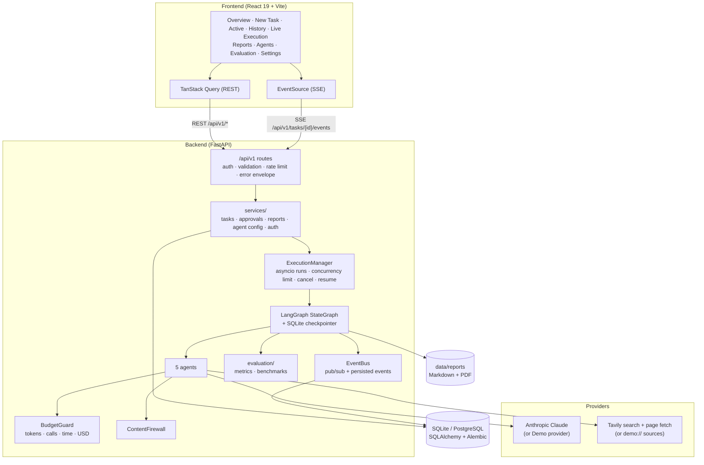

**Request lifecycle.**
1. `POST /api/v1/tasks` validates the objective and limits, resolves each agent's provider and model,
   and (in live mode) estimates cost.
2. The `ExecutionManager` launches the run as an asyncio task, bounded by `MAX_CONCURRENT_TASKS`.
3. The LangGraph graph executes the agents. Every step publishes events to the `EventBus`, which
   persists them and fans them out to SSE subscribers.
4. Results (subtasks, agent executions, sources, verifications, report, evaluation) are written to the
   database and the report files to `data/reports/`.

The design rationale is in [architecture.md](architecture.md).

## 8. The five agents

Each agent has a spec (`backend/app/agents/specs.py`) declaring its allowed tools. The allowlist is
enforced in code, not by the prompt. Each also has Pydantic input/output contracts
(`backend/app/schemas/agent_io.py`) and a prompt (`backend/app/agents/prompts.py`). LLM calls use
structured outputs. Invalid output gets at most one schema-repair round, and truncated output gets at
most one retry with a larger allowance.

### 8.1 Planner Agent
- **Input:** the objective and limits (max subtasks, 1–12).
- **Output:** an objective summary and a list of subtasks, each with an id, title, description,
  `depends_on` list and search queries.
- **Tools:** none.
- The plan is normalised before execution (`normalise_plan`): ids made unique, unknown or self
  dependencies dropped, cycles broken, and the subtask count trimmed to the limit. Every fix is recorded. With approval mode `plan` or `all`, the plan is shown to the user before any research starts.

### 8.2 Research Agent
- **Runs:** one instance per ready subtask, in parallel (LangGraph `Send`); dependent subtasks wait for
  their prerequisites.
- **Tools:** `web_search` (Tavily) and `fetch_page` (SSRF-guarded HTTP fetch + trafilatura extraction).
- **Output:** facts, each with a statement, a verbatim `evidence_quote` and a source id, plus coverage notes.
- **Source quality:** canonical-URL dedup, near-duplicate content merge (8-gram shingle Jaccard ≥ 0.85),
  relevance threshold 0.30, domain diversity (one page per domain first, at most 2 per domain).
- **Grounding gate:** each evidence quote is matched against the cited source text. The fact is
  either accepted, re-attributed to the source that really contains the quote (`citation_corrected`),
  or dropped (`citation_violation`). Fuzzy matching tolerates elisions but not changed names or numbers.
- A failed subtask is non-fatal: it is recorded and disclosed in the report.

### 8.3 Analysis Agent
- **Input:** all grounded facts.
- **Tools:** `calculator` (safe arithmetic evaluation).
- **Output:** consolidated claims with supporting fact/source references, calculations, conflicts and gaps.
- **Degradation:** if Analysis fails, the raw facts become claims so that verification and the report
  still happen (`agent_degraded`).

### 8.4 Verification Agent
- **Input:** claims plus evidence passages retrieved with BM25 from the stored sources.
- **Tools:** `retrieve_evidence`.
- **Output:** for each claim, a verdict (`supported`, `partially_supported`, `unsupported`,
  `conflicting`, `unverifiable`), a confidence, reasoning and evidence references. It also decides
  whether the research is sufficient or which gap queries to run.
- Guards in code: a verdict that cites none of the evidence shown becomes `unverifiable` (confidence ≤ 0.3),
  claims the model skipped are explicitly `unverifiable`, and confidence is capped for evidence from
  sources flagged for injection.
- **Degradation:** if Verification fails, claims are reported as unverified.

### 8.5 Report Generation Agent
- **Input:** objective, verified claims, sources, run statistics, and any budget/degradation notes.
- **Output:** Markdown report prose with `[S#]` citations.
- **Post-processing in code:** citations to unknown sources are removed and counted, and links, images,
  URLs and raw HTML not backed by stored sources are stripped. The reference list, run-statistics table,
  verification summary and limitations (budget, failed subtasks, degraded agents, conflicting claims)
  are generated by code from stored data, not by the model.
- Rendered to Markdown and PDF (ReportLab).

## 9. LangGraph orchestration and execution flow

The graph is built in `backend/app/graph/builder.py`:

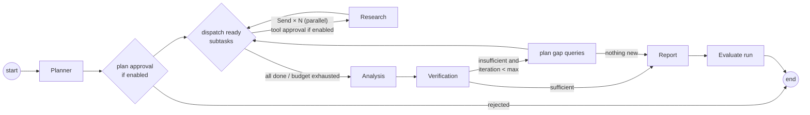

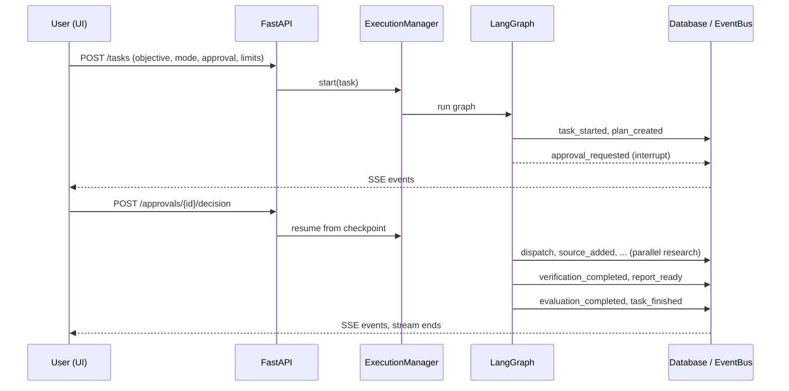

**Shared state** (`graph/state.py`) is a `TypedDict`. Keys that parallel branches write have reducers:
subtasks are deep-merged, facts/notes/errors appended, and flags OR-ed. A finalization fix gave
`budget_note` a reducer too (see §17.4). Only JSON-serialisable data lives in state, so it can be
checkpointed. Live objects (clients, budget guard, source registry) are passed as LangGraph runtime context.

**Reliability:**
- Infrastructure errors (`OperationalError`, `ConnectionError`) on nodes are retried by a LangGraph
  `RetryPolicy` (3 attempts, exponential backoff).
- LLM calls retry rate-limit, overload, 5xx, timeout and connection errors with full-jitter
  exponential backoff (≤ 30 s), honouring `retry-after` (capped at 60 s). Non-retryable errors
  (auth, invalid request) fail fast.
- Gap iterations are bounded by `max_iterations` (1–5). Queries already executed are not re-run.
- Concurrent searches per task are bounded by `MAX_PARALLEL_SEARCHES` (1 in sequential mode).
- Terminal task states are write-once: exactly one `task_finished` event per task.

## 10. Backend architecture and APIs

```
backend/app/
  main.py          app factory; lifespan: migrate DB, seed agent configs, build providers,
                   open checkpointer, mark interrupted runs, expire stale approvals
  api/routes/      auth, tasks (+SSE), approvals, reports, agents, insights, system
  services/        task_service, execution_manager, execution_store, budget, events,
                   report_renderer, pdf, agent_config_service, auth_service, db_lock
  graph/           state, nodes, builder, runner
  agents/          planner, research, analysis, verification, report, prompts, specs, runtime
  llm/             base interface, anthropic_provider, gemini_provider, factory, registry, retry
  tools/           search, fetch, evidence (BM25), quality (dedup/relevance), calculator
  security/        content_firewall
  demo/            demo providers + templates
  evaluation/      metrics, benchmarks
  config/          settings.py (pydantic-settings), pricing.json
```

All routes are under `/api/v1`. OpenAPI docs are at `/api/docs`. Errors use one envelope:
`{"error": {"code", "message", "request_id"}}`.

| Area | Endpoints |
|---|---|
| Auth | `POST /auth/login` (rate-limited 10/min), `POST /auth/logout`, `GET /auth/me` |
| Tasks | `POST /tasks`, `GET /tasks`, `GET /tasks/{id}`, `POST /tasks/{id}/cancel`, `POST /tasks/{id}/retry`, `DELETE /tasks/{id}` |
| Task detail | `GET /tasks/{id}/events` (SSE), `/sources`, `/verifications`, `/usage` |
| Approvals | `GET /approvals`, `POST /approvals/{id}/decision` with `{"approved": bool, "comment": str?}` |
| Reports | `GET /reports`, `GET /reports/{id}`, `GET /reports/{id}/download.md`, `GET /reports/{id}/download.pdf` |
| Agents / models | `GET /agents`, `PUT /agents/{key}`, `GET /models` |
| Insights | `GET /analytics/overview`, `GET /evaluations/summary`, `/evaluations/runs`, `/evaluations/tasks/{id}`, `/evaluations/benchmarks`, `/evaluations/benchmarks/{run_id}`, `POST /evaluations/benchmarks/{suite}/run` |
| System | `GET /health`, `GET /system/status` |

Task statuses: `queued`, `planning`, `awaiting_approval`, `running`, then one terminal state:
`completed`, `failed`, `cancelled`, `rejected` or `interrupted`.

## 11. Frontend modules

| Page | Purpose |
|---|---|
| Login | Session sign-in |
| Overview | KPIs, executions-per-day chart, status breakdown, agent performance, recent activity; All/Live/Demo filter |
| New Task | Objective, mode (Live disabled without keys / Demo), parallel or sequential, approval mode (none/plan/searches/both), per-task limits, per-agent switches |
| Active Executions | Running/queued tasks and pending approvals with inline approve/reject |
| Execution History | Search, status/mode filters, pagination, retry/delete |
| Live Execution | Progress, cost/token/call counters, five-stage workflow graph with parallel research batches, approval card, event timeline with filters, Sources / Verification / Outputs / Usage tabs, report download |
| Reports / Report Viewer | Report list; rendered report with contents, metrics, sources and verification panels; MD/PDF download |
| Agent Configuration | Per-agent model, effort, limits, timeout, retries and custom instructions (model selection needs a configured provider) |
| Evaluation | Live-run quality aggregates, agent reliability, verification benchmark runner, per-run metrics (demo rows labelled) |
| Settings | Integration status (configured / not configured, never the key), execution defaults, theme |

Implementation notes:
- `services/api.ts` is a typed REST client, and `hooks/` wraps it in TanStack Query with polling where useful.
- `services/event-stream.ts` and `hooks/use-task-events.ts` handle SSE with reconnect (see §13).
- Reports are rendered with react-markdown + remark-gfm, never as raw HTML. Only `http(s)` URLs become links,
  `demo://` shows as text, and remote images are not loaded.
- Dark/light theme, collapsible sidebar, and a mobile layout with a navigation sheet.

## 12. Database and migrations

Tables (`backend/app/models/`):

| Table | Contents |
|---|---|
| `users` | Admin user record |
| `tasks` | Objective, mode, status, limits, counters (tokens, calls, cost), runtime state, error |
| `subtasks` | Planner subtasks with dependencies, queries, status, iteration |
| `agent_executions` | One row per agent run: agent, model, mode, tokens, cost, duration, status |
| `execution_events` | Persisted event log (monotonic ids) used for SSE replay |
| `research_sources` | Retrieved sources with URL, content, quality and injection flags |
| `verification_results` | Claim, verdict, confidence, reasoning, evidence refs |
| `approval_requests` | Kind (plan/tools), payload, status, decision comment |
| `reports` | Markdown, metadata, citation-violation counts, file paths |
| `evaluation_results` | Per-run metrics JSON |
| `benchmark_runs` | Benchmark suite runs and results |
| `agent_configs` | Per-agent configuration overrides |

LangGraph checkpoints live in a separate SQLite file, `data/checkpoints.db`.

**Migrations:** Alembic (`backend/migrations`, revisions `0001_baseline` and `0002_tasks_runtime_state`).
The schema is migrated automatically on startup (`python -m app.database.migrations` runs it manually).
SQLite databases are backed up to `data/backups/` before any schema change, and nothing is migrated if
the backup fails. Older databases are adopted at the baseline and upgraded. `test_migrations.py`
covers these paths.

## 13. Real-time event streaming

- Every step emits typed events. Examples: `task_started`, `stage_changed`, `plan_created`,
  `approval_requested`, `dispatch`, `agent_started`, `tool_call`, `tool_result`, `source_added`,
  `sources_filtered`, `injection_flagged`, `citation_corrected`, `citation_violation`, `retry`,
  `repair`, `agent_degraded`, `iteration_started`, `verification_completed`, `report_ready`,
  `evaluation_completed`, `task_finished`.
- Events are persisted with monotonic ids before being published. `GET /tasks/{id}/events`
  subscribes first, then replays stored history after `Last-Event-ID` (or `?after=`), then streams
  live events. Nothing is lost between replay and live, and duplicates are skipped by id.
- A 15 s ping keeps idle connections open. The stream ends after `task_finished`, or immediately
  with an `end` event for a task that has already finished.
- The client reconnects automatically with `Last-Event-ID`, manually with `?after=<id>` and backoff,
  and a 35 s heartbeat watchdog detects silently dead connections.
- Ordering: `approval_requested` is persisted before the task can be decided, so a decision can
  never appear before its request in the timeline.

Verified in this session: a demo run produced 56 events, replayed in strictly increasing id order.
The Playwright spec `execution-3c.spec.ts` exercises reconnect and replay in the browser.

## 14. Approval and budget management

### 14.1 Human approval
- **Modes:** `none`, `plan` (after planning), `tools` (before each batch of web searches), `all`.
- Implemented with LangGraph `interrupt()`. The approval request is stored and the graph state
  checkpointed. A decision (approve/reject + optional comment) resumes the run from the checkpoint.
- Live runs whose cost estimate exceeds `APPROVAL_COST_THRESHOLD_USD` (default $2.00) always pause for approval.
- Pending approvals survive a server restart. Approvals older than `APPROVAL_TIMEOUT_HOURS` (default 24)
  expire and the task is cancelled. This is checked at startup and on each decision.
- The approve/commit race found in Phase 4 is fixed. A resumed run is chained behind the paused run,
  and terminal states are write-once.

### 14.2 Budget enforcement
- **Per-task limits:** total tokens, LLM calls, tool calls, wall time, USD, iterations, subtasks and
  searches per subtask. Tasks may lower the server defaults. Values above server ceilings are clamped
  (verified: a request for 99,999,999 tokens was stored as 2,000,000).
- **Before each LLM call**, output tokens are clamped so the worst-case cost fits the remaining cap,
  minus in-flight reservations and a priced reserve for the final report.
- A cost cap with any unpriced model or search provider fails up front (`cost_limit_unenforceable`)
  rather than running unbounded.
- **When a limit is hit**, remaining research is skipped and a report is still produced with a budget
  note. Verified in this session in demo mode: `max_llm_calls=2` → completed with 2/2 calls.
- Pricing lives in `backend/app/config/pricing.json`. Unknown prices make cost `null`; they are never guessed.

## 15. Security and reliability mechanisms

| Area | Mechanism |
|---|---|
| Authentication | Single admin; bcrypt hash supported; HTTP-only, SameSite=Lax signed JWT cookie; login rate-limited to 10/min; every route except `/health`, `/auth/login` and `/auth/logout` requires a session |
| Production safety | Startup refuses the built-in dev JWT secret and the `.env.example` placeholder (finalization fix), and a plain-text admin password, when `APP_ENV=production` |
| Secrets | Keys are `SecretStr`; a logging filter redacts known key shapes; errors, events and tracebacks are sanitised; the API reports only "configured: true/false". Tests use fake keys and assert they never appear |
| Prompt injection | `ContentFirewall`: Unicode tag-character smuggling decoded and stripped, rule-based flags (instruction override, role markers, verdict/citation manipulation), untrusted text only inside escaped data wrappers in the user channel, confidence caps for flagged sources |
| Tool safety | Per-agent tool allowlist enforced in code; fetcher only reads URLs returned by search; SSRF guard blocks private/loopback addresses |
| Anti-fabrication | Quote-grounding gate; citation filtering; references generated from stored sources; links/images/HTML in report prose removed and disclosed |
| Reliability | Retries with backoff, schema repair, truncation retry, non-fatal research failures, degraded-agent fallbacks, restart recovery (`interrupted`), write-once terminal states, cancellation |

## 16. Demo-mode implementation

- `backend/app/demo/` provides a demo LLM provider and a demo search provider. They return fixed templates
  shaped like real agent outputs, and synthetic sources at `demo://source/...` URLs.
- Demo runs go through **the same graph, agents, gates, events, reports and evaluation code** as live
  runs. Only the providers differ, so demo mode exercises the real orchestration.
- Labelling: the task is marked `DEMO` throughout the UI. Every generated title, subtask, fact and
  paragraph is prefixed `[DEMO]`. The report opens with "DEMO MODE — this content was generated from
  fixed templates, not by an AI model, and cites synthetic demo:// sources. It is not research."
  Demo runs are shown separately in analytics and evaluation, and are excluded from live aggregates.
- Live mode is never silently replaced by demo mode. Without keys, a live task is refused with
  `409 provider_not_configured`, and the UI disables the Live option.

## 17. Testing methodology and results

All results below were produced on 25 November 2026 on the final code (`feature/phase-4-advanced-ai`).

### 17.1 Methodology
- **Backend unit tests** (`tests/unit`, 164 tests): agents, budget, LLM providers (error mapping,
  retries, truncation, fallbacks), quality gates, security and tools, settings and log redaction.
- **Backend integration tests** (`tests/integration`, 71 tests): full workflows on fake LLM/search
  providers (parallel, sequential, gap iterations, approvals, failures, budget exhaustion, cancel,
  restart recovery, demo labelling), API endpoints, auth, migrations, secret-exposure audit, Phase 4
  orchestration and security.
- **Live tests** (`tests/live`, 12 tests, opt-in `-m live`): real Anthropic/Tavily calls, each with a
  hard cost cap. A missing key is a skip, never a pass.
- **Frontend unit tests** (Vitest + Testing Library + mock server, 60 tests in 4 files).
- **Browser end-to-end tests** (Playwright, 5 tests in 4 specs) against the **real backend and the
  Vite dev server** in demo mode, including console-error checks and phone-width overflow checks.
- **Manual API journey:** scripted walkthrough of the user journey against a running server.

### 17.2 Results

| Suite | Command | Result |
|---|---|---|
| Backend offline | `cd backend && python -m pytest` | **235 passed**, 12 live deselected (≈ 105 s) |
| Frontend unit | `cd frontend && npm test` | **60 passed** (4 files) |
| Lint | `npm run lint` | **0 errors**, 7 warnings (`only-export-components`, fast-refresh only) |
| Typecheck | `npm run typecheck` | **pass** |
| Production build | `npm run build` | **pass** |
| Browser E2E | `npx playwright test` | **5/5 passed**; **15/15** with `--repeat-each=3 --workers=1` |
| Live: invalid key / timeout | `pytest -m live -k "invalid_key or timeout"` | **3 passed** against the real Anthropic and Tavily endpoints (no cost) |
| Live: paid tests | `pytest -m live` | **9 skipped**: credentials not configured |

### 17.3 Demo-mode user journey (API, real server, scratch database)

| Step | Observed result |
|---|---|
| Unauthenticated `GET /tasks`; wrong password | 401; 401 |
| Login | 200 |
| `GET /system/status` | `live_mode_available: false` |
| Create a live task | 409 `provider_not_configured` |
| Create a demo task with `approval_mode=plan` | status `awaiting_approval`, 1 pending `plan` approval |
| Approve with comment | 200 → status `completed` |
| Agents executed | planner, research (×3 subtasks), analysis, verification, report: all `completed` |
| Events | 56 events, ids strictly increasing |
| Sources / verifications | 6 sources, 4 verification results |
| History | task listed |
| Report download | `.md`: 200, `text/markdown`, attachment filename prefixed `DEMO-`; `.pdf`: 200, `application/pdf`, valid `%PDF-` header |
| Evaluation | `GET /evaluations/tasks/{id}` 200 with metrics |
| Budget | `max_llm_calls=2` → completed, 2/2 calls, budget-limited report |

All of the above is **demo output**: fixed templates and synthetic sources, not AI-generated research.

### 17.4 Defects found and fixed during finalization
1. **Budget exhaustion in parallel branches crashed the task.** Two research branches hitting the
   limit in the same step both wrote `budget_note`, LangGraph raised `InvalidUpdateError`, and the
   task failed. Fixed with a reducer. Regression test:
   `test_budget_exhausted_in_parallel_branches_still_produces_report` (live + demo).
2. **Production accepted the `.env.example` JWT placeholder.** Fixed. Regression test:
   `test_production_refuses_known_placeholder_jwt_secret`.
3. **Pending-approval card overflowed by 8 px at 390 px width.** Fixed (`min-w-0`). The Playwright
   responsive check now creates a pending approval to cover it.
4. A test-only race in the 3C browser spec (late-logged expected 404s) was fixed by filtering on URL.

Each regression test was confirmed to fail without its fix.

### 17.5 Real AI integration status
**Not verified.** The environment had no `ANTHROPIC_API_KEY` or `TAVILY_API_KEY`. The following were
**not executed**: model listing, each agent with a real model, real Tavily search, the five-agent live
end-to-end run, and the live verification benchmark. The tests and their spending caps exist and are
documented step by step in [phase4.md § Live verification runbook](phase4.md#live-verification-runbook):
$0.40 per agent test, $2.00 for the end-to-end run, $1.50 for the benchmark. Their correctness was
dry-run offline with fake providers and all sockets blocked. No statement in this report about
orchestration, gates or reports implies that real model output was observed.

## 18. Benchmark results

### 18.1 Safety-gate benchmark (offline, measured)
`python -m app.evaluation.benchmarks guards`: 44 labelled cases in `backend/evals/datasets/guards.jsonl`,
deterministic, no model involved. Re-run on 25 November 2026 with identical results:

| Gate | n | Accuracy | Precision | Recall | Misses |
|---|---|---|---|---|---|
| Quote grounding | 18 | 0.944 | 1.000 | 0.900 | q18: "per cent" vs "percent", a valid fact dropped |
| Injection detection | 20 | 0.900 | 0.857 | 1.000 | i14, i20: benign text flagged |
| URL dedup | 6 | 1.000 | 1.000 | 1.000 | – |
| **Overall** | 44 | **0.932** | **0.923** | **0.960** | |

All errors fail safe: no fabricated quote was accepted and no injection was missed. The cost of
the errors is a dropped valid fact or a benign source marked lower-reliability.

### 18.2 Verification benchmark (live, **not run**)
`backend/evals/datasets/verification.jsonl` has 26 hand-labelled synthetic items (including
number/date/location substitutions, disagreeing sources and verifier-directed injection). It reports
accuracy, binary accuracy and Brier score. It requires a real model and **has not been run**, so there
are no results to report.

## 19. Screenshots

Captured on 25 November 2026 from the running application (real backend + frontend) in **demo
mode**. All task content shown is template output, and the UI labels it as such. The orange banner
("Live AI execution is not configured") reflects the actual state of this environment.

| | |
|---|---|
| **Overview dashboard**<br/>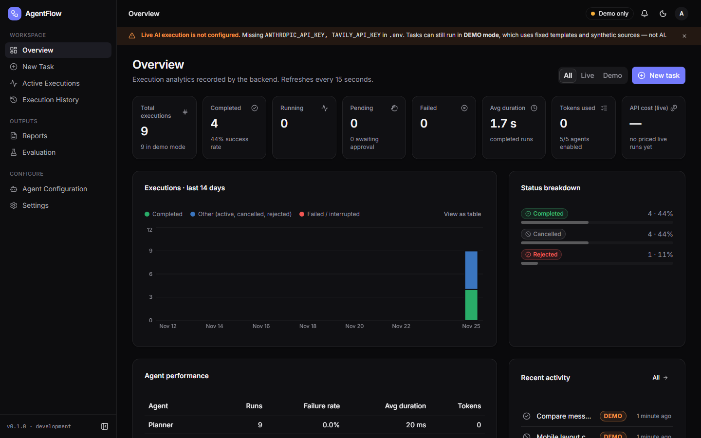 | **New Task** (Live disabled without keys)<br/>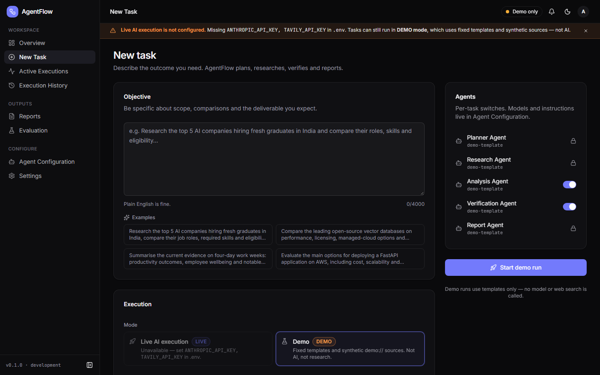 |
| **Plan approval checkpoint**<br/>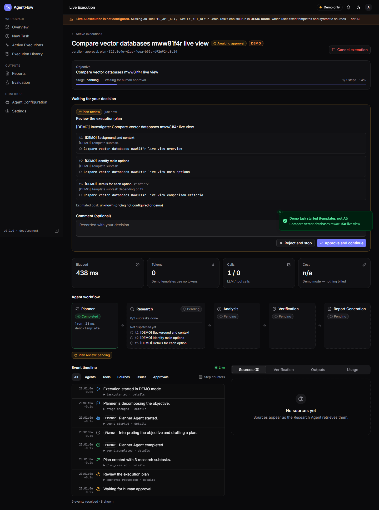 | **Live execution: five-agent workflow, timeline, sources**<br/>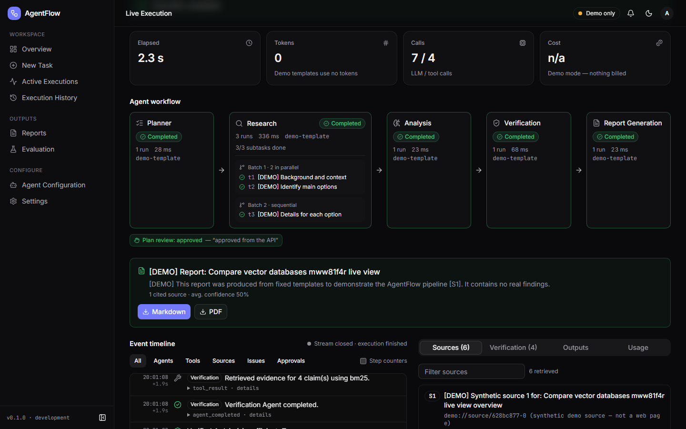 |
| **Execution history**<br/>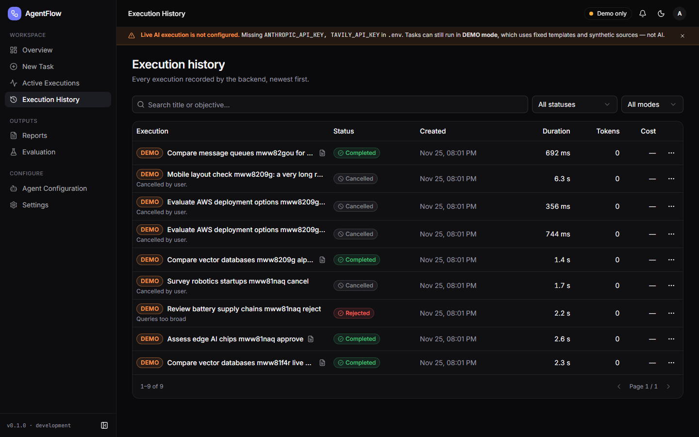 | **Evaluation dashboard**<br/>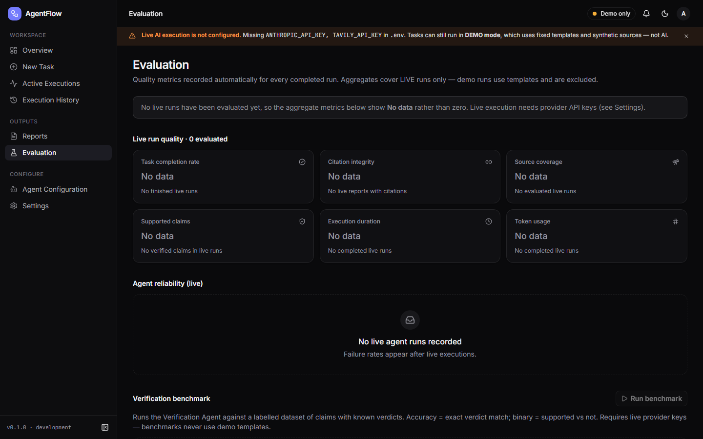 |
| **Agent configuration**<br/>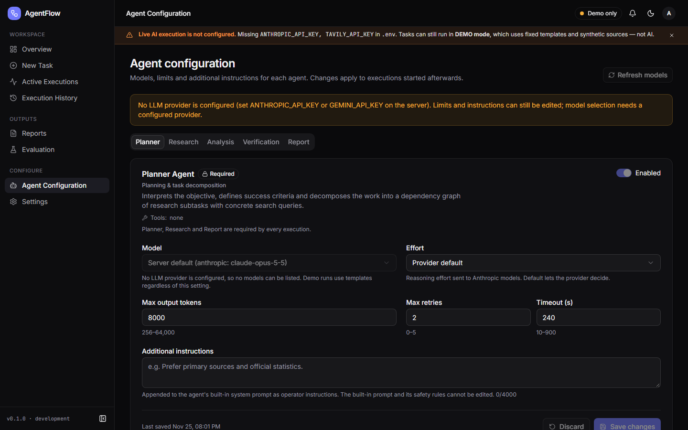 | **Mobile layout (light theme)**<br/>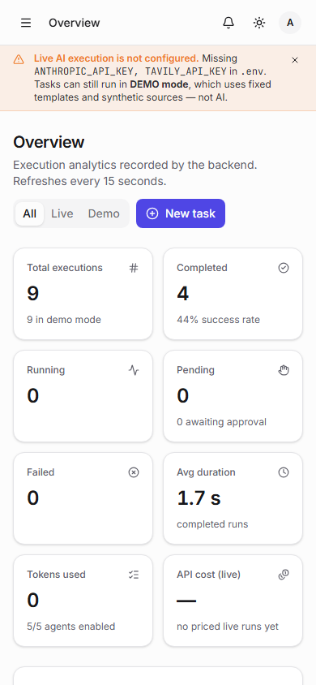 |

**Report viewer** (demo report, full page): [screenshots/06-report-viewer.png](screenshots/06-report-viewer.png)

## 20. Setup and execution

**Requirements:** Python 3.13 (3.12+ expected to work), Node.js 20+ and npm, Git. Live mode also
needs an Anthropic API key with API credits and a Tavily key. A Claude Pro/Max subscription does
not include API credits.

```bash
git clone <repository-url> agentflow
cd agentflow
cp .env.example .env              # Windows: copy .env.example .env

# Backend (terminal 1)
cd backend
python -m venv .venv
.venv\Scripts\activate            # macOS/Linux: source .venv/bin/activate
pip install -r requirements-dev.txt
uvicorn app.main:app --reload --port 8000

# Frontend (terminal 2)
cd frontend
npm install
npm run dev                       # open http://localhost:5173, sign in admin / admin
```

The database is created and migrated automatically on first start. To run in demo mode, leave the API
keys empty and choose **Demo** on the New Task page. To enable live mode, set `ANTHROPIC_API_KEY`,
`ANTHROPIC_DEFAULT_MODEL` (must be in `pricing.json`, e.g. `claude-sonnet-5-5`) and `TAVILY_API_KEY`,
then restart the backend. For production, set `APP_ENV=production`, a random `JWT_SECRET` and
`ADMIN_PASSWORD_HASH`.

**Tests:**
```bash
cd backend && python -m pytest                          # offline suite
python -m app.evaluation.benchmarks guards              # offline gate benchmark
cd frontend && npm test && npm run lint && npm run typecheck && npm run build
npx playwright install chromium && npx playwright test  # needs backend :8000 and npm run dev :5173
```

## 21. Known limitations

1. **Live AI execution is unverified** with real credentials (see §17.5).
2. Injection detection is heuristic, with measured false positives. Structural isolation is the primary control.
3. Quote grounding proves a quote exists in a source, not that the statement follows from it. That
   judgement belongs to the Verification agent.
4. The cost cap uses an input-token estimate (~3.5 characters/token), so actual spend can exceed the
   cap by the estimation error of in-flight calls.
5. Single admin user; no roles or multi-tenancy.
6. LangGraph checkpoints are always SQLite (single node); PostgreSQL migrations run without automatic backup.
7. Evidence retrieval is BM25 (no embeddings).
8. The SSRF guard has a theoretical DNS-rebinding window.
9. The UI does not yet display the Phase 4 grounding/cost metric blocks or the `guards` suite (the API returns them).
10. `npm audit` reports high-severity advisories in Vite's dev-dependency chain; the fix needs a breaking upgrade.
11. Playwright specs share one backend and should not be run with `--repeat-each` in parallel workers.

## 22. Future enhancements

- Execute the capped live verification runbook and publish the measured agent, end-to-end and
  verification-benchmark results.
- Visualise the Phase 4 evaluation metrics and the guards benchmark in the Evaluation dashboard.
- Embedding-based evidence retrieval alongside BM25.
- PostgreSQL checkpointer and multi-node execution; container packaging.
- Multi-user accounts with roles and per-user preferences.

## 23. Conclusion

AgentFlow delivers a complete, tested multi-agent research platform. It provides typed agent contracts,
LangGraph orchestration with parallelism, bounded loops and human checkpoints, code-enforced grounding
and budgets, defence against untrusted web content, a live observable UI, and per-run evaluation. The
offline verification is extensive: 235 backend tests, 60 frontend tests, 5 browser tests against the
real backend, a measured safety-gate benchmark, and a full demo-mode user journey. Three genuine defects
were found and fixed during finalization. The remaining step is running the prepared, cost-capped live
test suite with real API credentials. Until that happens, AgentFlow's real-model behaviour should be
considered unverified.

## 24. References

- Project documents: [README](../README.md), [architecture.md](architecture.md), [roadmap.md](roadmap.md), [phase4.md](phase4.md)
- LangGraph documentation: <https://docs.langchain.com/oss/python/langgraph>
- Anthropic Claude API documentation: <https://docs.claude.com>
- Tavily API documentation: <https://docs.tavily.com>
- FastAPI: <https://fastapi.tiangolo.com> · SQLAlchemy: <https://docs.sqlalchemy.org> · Alembic: <https://alembic.sqlalchemy.org>
- React: <https://react.dev> · TanStack Query: <https://tanstack.com/query> · Playwright: <https://playwright.dev>
- Robertson & Zaragoza, "The Probabilistic Relevance Framework: BM25 and Beyond" (2009), the basis of the evidence retrieval
